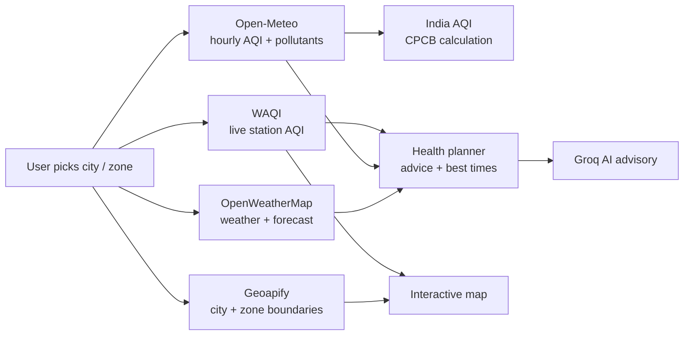

# 🌍 Air Monitoring AI System

[](https://www.python.org/)
[](https://streamlit.io/)
[](LICENSE)

A **real-time Air Quality Index (AQI) & weather dashboard for Indian cities**, built with Streamlit. It shows live pollution from official monitoring stations, real hourly AQI forecasts, India's official AQI (CPCB), personalised health advice, the best time to go outside, city-to-city comparisons, an AI advisory and local pollution news.

**Live demo:** https://your-app-name.streamlit.app <!-- replace with your Streamlit link -->


---

## Table of contents

- [Features](#-features)
- [What's new in v2](#-whats-new-in-v2)
- [How it works](#-how-it-works)
- [Tech stack](#-tech-stack)
- [APIs used](#-apis-used)
- [Project structure](#-project-structure)
- [Getting started](#-getting-started)
- [Deploying to Streamlit Community Cloud](#-deploying-to-streamlit-community-cloud)
- [Limitations](#-limitations)
- [Roadmap](#-roadmap)
- [License](#-license)

---

## ✅ Features

**Live monitoring**
- Search any city, load its administrative zones and colour the selected zone by live AQI.
- Monitoring stations on the map with colour-coded AQI, a station ranking chart, cleanest/most polluted station, and CSV download.
- Six headline metrics: US AQI (with 24-hour change), **India AQI (CPCB)**, temperature (feels-like), humidity, wind and an **Outdoor score**.

**Forecast & trends**
- **Real hourly AQI** for the last 2 days and next 4 days, with health-level bands and a "Now" marker.
- **Pollutant breakdown**: PM2.5, PM10, NO₂, O₃, SO₂ and CO over time.
- 5-day weather forecast (temperature + humidity) and CSV export of hourly data.

**Health planner**
- **Personalised advice** for 7 health profiles (children, elderly, asthma, heart condition, pregnancy, outdoor workers, general public) covering outdoor activity, masks and indoor air.
- **Best time to go outside**: the cleanest daytime windows in the next 24 hours.
- **Daily outlook**: average and worst AQI for each coming day.
- **Personal AQI alert**: a warning banner when AQI is above your chosen level.

**Compare cities**
- Live ranking of 16 major Indian cities (plus your current city) on a bar chart and an India map.
- Cleanest and most polluted city right now, and your city's rank.

**AI advisory & news**
- AI-written advisory tailored to your city, zone, weather, health profile and best-time windows (Groq LLM), with an automatic rule-based fallback.
- Latest local air-pollution headlines from Google News.

**Accounts**
- Register and log in with username or email; passwords are securely hashed.
- **Saved cities** for one-click access, and saved health preferences.

---

## 🆕 What's new in v2

| Area | Before (v1) | Now (v2) |
|---|---|---|
| AQI forecast | Simulated (current AQI +1 per hour) | Real hourly history + 4-day forecast (Open-Meteo / CAMS) |
| AQI scale | US AQI only | US AQI **and India's CPCB National AQI** |
| Health | Generic tips | 7 health profiles, mask/indoor advice, best time to go out, daily outlook, personal alerts |
| Comparison | — | 16-city live ranking with map |
| Pollutants | — | PM2.5, PM10, NO₂, O₃, SO₂, CO charts |
| Station chart | Pie chart (summed AQI values) | Colour-coded station ranking |
| AI advisory | DeepAI text generator | Groq LLM with rule-based fallback |
| News | NewsAPI (developer-only plan) | Google News RSS (no key needed) |
| Accounts | Plain-text passwords, local Postgres | Hashed passwords, cloud Postgres (Neon), saved cities & preferences |
| API keys | Hard-coded in source | Streamlit Secrets |
| Performance | Every click re-called every API | Cached API calls (10–30 min live data, 24 h boundaries) |
| Reliability | Crashed on missing data | Timeouts and graceful "data unavailable" messages |
| Export | — | CSV downloads |

---

## ⚙️ How it works



**India AQI (CPCB):** the app converts 24-hour average PM2.5 and PM10 concentrations into sub-indices using CPCB breakpoints (Good, Satisfactory, Moderate, Poor, Very Poor, Severe) and reports the highest one.

**Best time to go outside:** the hourly forecast for the next 24 hours is scanned for the 2-hour daytime windows (6 am–9 pm) with the lowest average AQI.

---

## 🛠 Tech stack

- **Python 3.11+**, **Streamlit**
- **Folium** + **streamlit-folium** (maps), **Shapely** (zone geometry)
- **Plotly** (charts), **Pandas** (data)
- **SQLAlchemy** + **psycopg 3** with **PostgreSQL on Neon**
- **Werkzeug** (password hashing)
- **Groq** (optional AI advisory)

---

## 🌐 APIs used

| API | Purpose | Key needed |
|---|---|---|
| [WAQI](https://aqicn.org/data-platform/token/) | Live AQI from monitoring stations | Yes (free) |
| [OpenWeatherMap](https://openweathermap.org/api) | Current weather and 5-day forecast | Yes (free) |
| [Geoapify](https://www.geoapify.com/) | City search and zone boundaries | Yes (free tier) |
| [Open-Meteo Air Quality](https://open-meteo.com/en/docs/air-quality-api) | Hourly AQI and pollutant history/forecast | No |
| [Google News RSS](https://news.google.com/) | Local pollution headlines | No |
| [Groq](https://console.groq.com) | AI advisory | Optional |

---

## 📁 Project structure

```
air-monitoring-ai-system/
├── app/
│   ├── app.py                      # Entry point: page setup, secrets check, login vs dashboard
│   ├── main_dashboard.py           # Sidebar, metrics and the five dashboard tabs
│   ├── requirements.txt            # Python dependencies (used by Streamlit Cloud)
│   ├── models/users.py             # Tables: aqi_users, aqi_saved_cities
│   ├── services/
│   │   ├── waqi_service.py         # Live station AQI
│   │   ├── weather_service.py      # Weather + forecast
│   │   ├── geoapify_service.py     # City geocoding + zones
│   │   ├── air_quality_service.py  # Hourly AQI/pollutants, multi-city comparison
│   │   ├── health_service.py       # Health advice, outdoor score, best times, outlook
│   │   ├── ai_agent_service.py     # Groq advisory + Google News
│   │   ├── forecast_service.py     # Plotly charts
│   │   ├── map_service.py          # Folium maps
│   │   ├── user_service.py         # Accounts, saved cities, preferences
│   │   └── login_register_service.py
│   ├── setting/constants.py        # Settings (keys come from secrets), city list, profiles
│   └── utils/
│       ├── color_utils.py          # US AQI + India CPCB AQI scales
│       ├── database.py             # Database connection
│       └── http.py                 # API requests with timeouts
├── .streamlit/secrets.toml.example # Template for your keys
├── .devcontainer/                  # GitHub Codespaces setup
└── README.md
```

---

## ⚡ Getting started

1. **Clone the repository**
   ```bash
   git clone https://github.com/harishnemade100/air-monitoring-ai-system.git
   cd air-monitoring-ai-system
   pip install -r app/requirements.txt
   ```

2. **Get your keys:** WAQI, OpenWeatherMap and Geoapify (all free), plus a free [Neon](https://neon.tech) PostgreSQL database. Groq is optional.

3. **Add secrets:** copy `.streamlit/secrets.toml.example` to `.streamlit/secrets.toml` and fill in your values. Tables are created automatically on first run.

4. **Run**
   ```bash
   streamlit run app/app.py
   ```
   Open http://localhost:8501 and create an account.

---

## 🚀 Deploying to Streamlit Community Cloud

1. Push the repository to GitHub (never commit `secrets.toml`).
2. On [share.streamlit.io](https://share.streamlit.io) click **Create app** and set:
   - **Repository:** this repository, **Branch:** `main`
   - **Main file path:** `app/app.py`
3. Under **Advanced settings**, choose Python 3.12 and paste the contents of your `secrets.toml` into **Secrets**.
4. Click **Deploy**.

---

## ⚠️ Limitations

- Forecasts and city comparisons use Open-Meteo model data (CAMS), which can differ from station readings.
- The India AQI here uses PM2.5 and PM10 only; the official CPCB index can also include other pollutants.
- Zone boundaries depend on what Geoapify has for each city.
- Login does not survive a page refresh (data stays saved).
- Health advice is general guidance, not medical advice.

---

## 🗺 Roadmap

- [ ] Email / Telegram alerts when AQI crosses a user's threshold
- [ ] Historical trends (30/90 days) and seasonal analysis
- [ ] Machine-learning AQI forecast trained on station history
- [ ] Zone-level AQI heatmap for all zones at once
- [ ] Hindi and Marathi language support
- [ ] Persistent login (Google sign-in)
- [ ] Mobile-friendly layout and PWA install

---

## 📄 License

MIT

**Author:** Harish Nemade · [GitHub](https://github.com/harishnemade100)
